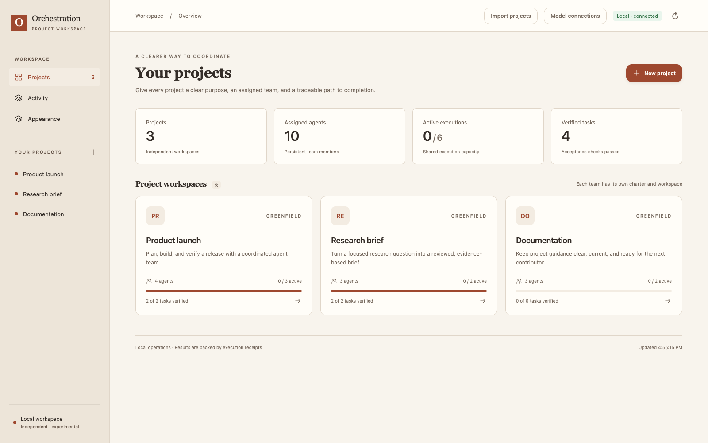
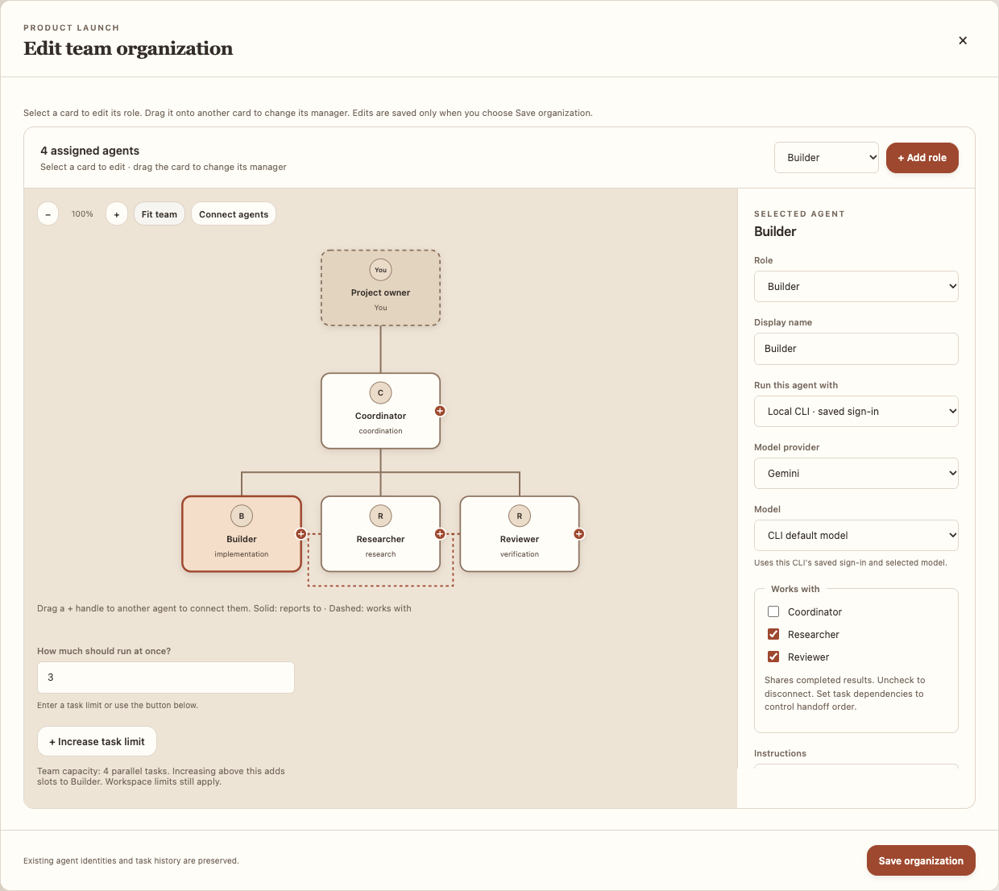
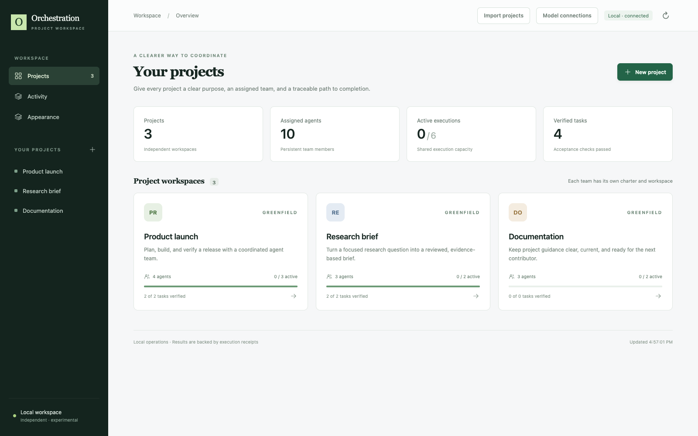
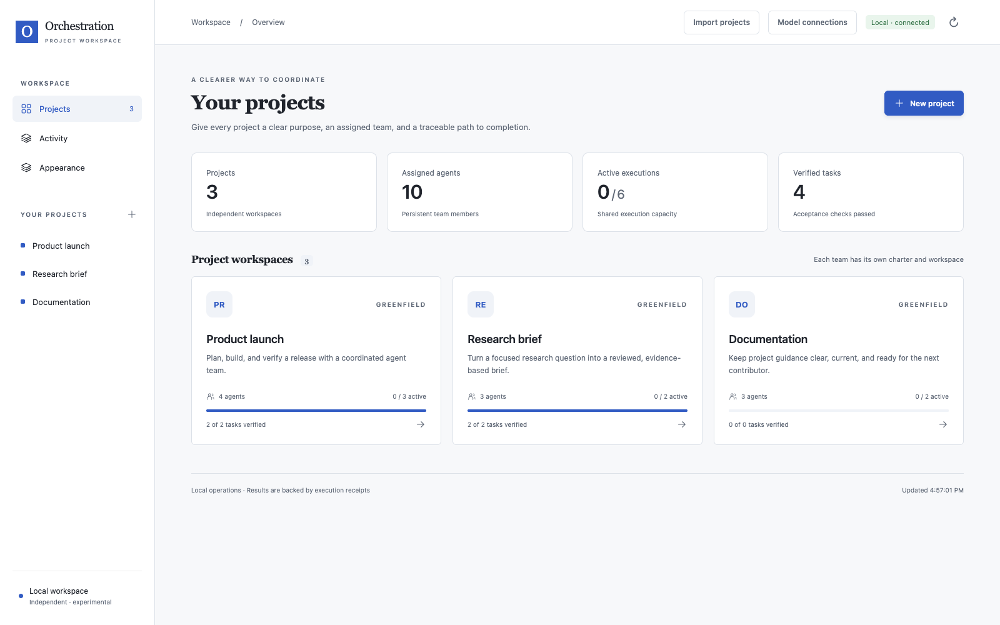
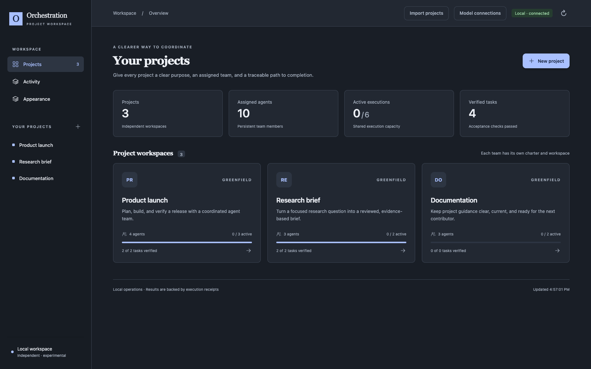
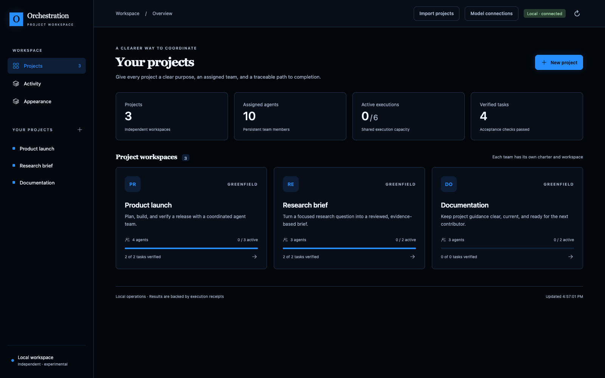
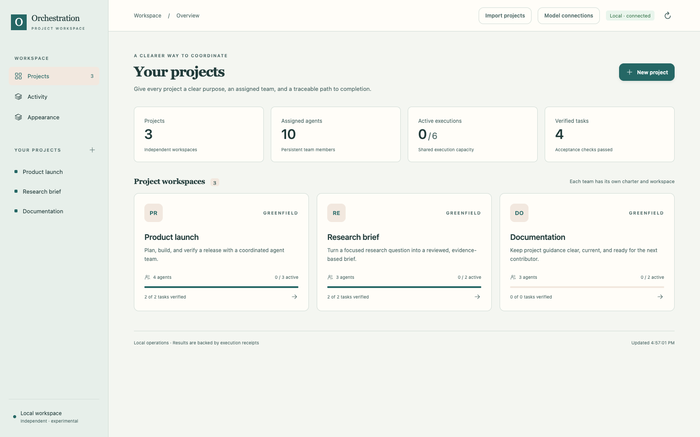
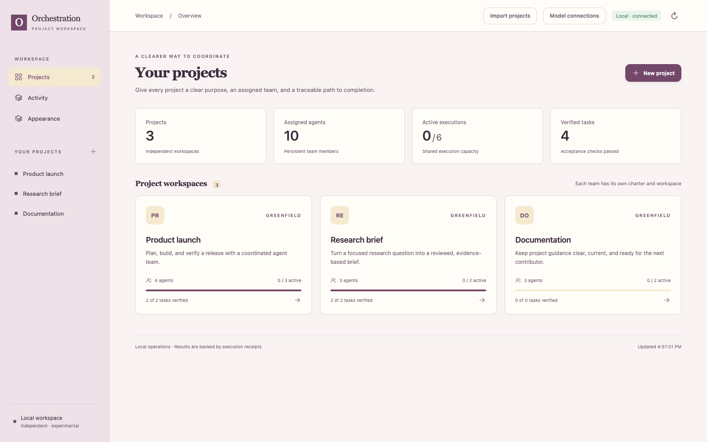

# Agentic Orchestration

**A backend foundation and open design for coordinating multiple agents across concurrent tasks.**

Agents can execute work. Orchestration decides which work should happen, who owns it, what can run together, and whether the result actually satisfies the goal.

This repository develops a shared vocabulary, practical patterns, and testable contracts for that coordination. It covers a portfolio of goals and tasks—not only a single prompt delegated to several agents.

**Status: experimental backend and draft design v0.1.** This is not an official standard, production-ready service, or claim of consensus. Existing research and frameworks already address parts of this problem; our contribution is a coherent, falsifiable starting point for multi-task coordination. The design is independent of any provider, organization, private bridge installation, or framework. Research citations identify sources and do not imply affiliation or endorsement.

## Screenshots

Sample projects shown in the **Warm minimal** theme.

**Workspace overview** — project workspaces, assigned agents, and execution progress.



**Editable agent organization** — roles, reporting lines, peer connections, and per-agent model selection.



### Color themes

The same sample workspace in the other six palettes. **Warm minimal** is shown above. Choose a preview to view it at full size; colors and typography can be selected independently in **Appearance**.

| Original green | Crisp neutral |
| --- | --- |
| [](docs/images/theme-original.png) | [](docs/images/theme-neutral.png) |

| Dark graphite | Neon blue |
| --- | --- |
| [](docs/images/theme-graphite.png) | [](docs/images/theme-neon.png) |

| Ocean & clay | Plum & honey |
| --- | --- |
| [](docs/images/theme-ocean.png) | [](docs/images/theme-plum.png) |

## Run the backend

Python 3.10+ on macOS or Linux; no third-party runtime dependencies.

```sh
python3 -m orchestration examples/backend_goal.json --project examples/greenfield_project.json --execution-limit 4 --data-dir .runtime/example
python3 app.py --port 8765 --execution-limit 4
```

The first command runs an explicit task graph and prints its result. The second starts the JavaScript project workspace and its authenticated JSON API at `http://127.0.0.1:8765`. The backend initializes projects with charters and assigned agent teams, persists goals, tasks, attempts, and receipts, enforces dependencies and resource conflicts, and executes bounded local operations. Model tasks use OpenAI, Claude, or Gemini through a saved local CLI sign-in or an API key. Each agent has its own execution method, provider, model, and collaboration links. Remote bridges and autonomous tool use are not implemented. See the [backend implementation](docs/backend.md) for the module map, request flow, API, and limitations.

## Portable packaging

A clean checkout runs with Python's standard library; no local Node modules,
provider binaries, credentials, or workspace data are included. The Dockerfile
bundles the runtime for another machine, and hosted mode disables local-computer
integrations. See [portable runtime and deployment](docs/deployment.md) for
container setup and authentication. Uploading this repository does not deploy a
live service.

## JavaScript frontend

The frontend lives separately in [`frontend/`](frontend/README.md) and uses plain JavaScript modules and CSS. It supports project charters, editable agent rosters, goal and dependency creation, task inspection, artifacts, cancellation, and live state refresh. It connects to the same local backend; no bundler or JavaScript runtime is required to serve it.

For development checks:

```sh
npm ci --prefix frontend
npm test --prefix frontend
```

## Import local projects

Choose **Import projects** in the workspace header, select a search folder, and click **Scan folder**. Review paths and detected project types, filter the results, then check the projects to import. Nothing is selected or imported automatically. For a project without standard markers, enable **Also list this folder** before scanning its folder.

Discovery reads filenames, not project contents, and does not run repository code. It recognizes Git and common JavaScript, Python, Rust, Go, Java/Kotlin, Swift/Xcode, .NET, Ruby, PHP, C/C++, Dart, Elixir, and Docker markers. Discovery treats a detected project as one result; to find nested projects, scan that project folder directly. Hidden folders, dependency/build directories, and nested symbolic links are skipped. Scans are bounded to five directory levels, 10,000 directories, 200 results, and ten seconds; incomplete or unreadable coverage is shown in the review. Scan selections expire after 30 minutes or a new scan.

Import registers the canonical source location and an editable three-role team. Re-importing the same path returns the existing project. Source files are not copied or changed. On model tasks, select specific project files to provide real source context; generated output still goes to the app’s isolated artifact workspace. The source location is retained after restart and displayed on the project overview.

Discovery routes use the same local session authorization as other APIs: `GET /api/projects/scan-roots`, `POST /api/projects/scan`, and `POST /api/projects/import`.

## Model execution and collaboration

1. Open **Model connections → Local CLI**. Use your saved Codex CLI, Claude Code, or Antigravity (`agy`) account. The screen checks sign-in automatically and updates when confirmed. Alternatively connect a provider under **API keys**.
2. Open a project's team editor. Choose the **Team model** once and apply it to the entire team, then adjust individual agents only when needed. Local CLI is first and is the default for new local teams and imports. **CLI default** uses the tool's default model. Supported Codex models also offer Standard, Fast, or Ultrafast execution. Connect peers by dragging a card’s **+ handle** onto another agent, or choose **Connect agents** and click two cards.
3. Open **New goal**, describe the outcome, and attach relevant project files. **Plan with coordinator** uses the saved chart—roles, instructions, reporting lines, and peer connections—to propose task assignments and handoffs. Review or edit that plan, then choose **Start goal**. Planning does not start the proposed tasks.

You can also choose **Define tasks manually**. Result filenames are supplied automatically; optional output settings are under **Advanced settings**. CLI tasks have no output-token target unless you set one. If the chart changes after planning, generate a new plan before starting.

Model choices use names and descriptions supplied by the native tools. Claude Code exposes its supported model families and versions; Antigravity separates Gemini models from other available families. Selecting a model shows its description and, when provided, the model behind a family alias.

The scheduler enforces task order, project/agent capacity, and file conflicts. Model tasks receive explicitly selected source files, the project charter, their role/instructions, team roster, and available completed outputs from explicit dependencies and collaborating agents. Dashed chart links show collaboration; solid links show reporting. Collaboration does not make tasks wait automatically. Only task dependencies impose execution order.

Results are saved as project-scoped text artifacts with execution method, provider, model, usage, and response metadata. A completed model response is not a guarantee of factual correctness; assign a reviewer for content review. CLI turns run in isolated temporary directories with model tools disabled or denied. The model cannot directly execute shell commands or change project source files through this action. No provider fallback or automatic retry is performed.

CLI credentials remain in their native credential stores and are reused across app restarts. API keys entered in the UI remain in server memory and are cleared on restart. Alternatively configure `OPENAI_API_KEY`, `ANTHROPIC_API_KEY`, or `GEMINI_API_KEY` in the server environment; those reload on restart. Never commit credentials. API disconnect removes the running process's key. Hosted workspaces use API connections only; local CLI execution is unavailable there. Existing explicit API assignments remain unchanged.

See [model execution](docs/model-execution.md) for limits and provider references.

## Three parts, one repository

| Part | Responsibility | Design |
| --- | --- | --- |
| **Orchestration** | Coordinate agents and tasks, dependencies, priorities, ownership, budgets, and outcomes. | [Coordination specification](docs/specification.md) |
| **Execution** | Describe agent sessions, terminal jobs, files, browsers, desktops, and artifact transfer through capability-based adapters. | [Execution contract](docs/execution.md) |
| **Connection and permissions** | Identify targets, authenticate connections, scope access, isolate sessions, and recover safely. | [Connection design](docs/connections.md) |

The [architecture](docs/architecture.md) explains how these parts cooperate. The [capability catalog](docs/capabilities.md) describes intended coverage; these adapter capabilities are proposals, not working integrations. The initial neutral profiles are **local service** and **remote SSH**. Existing private bridges remain outside this repository and unchanged.

This is a public-facing design prepared in a private repository. Repository visibility and the MIT license are separate: the license does not make a private GitHub repository public.

## Start here

- [Working backend](docs/backend.md): code organization and how modules coordinate.

- [Three-part walkthrough](examples/three_part_walkthrough.md): concurrent work across neutral environments.
- [Design principles](docs/principles.md): proposed practices and their tradeoffs.
- [Coordination specification](docs/specification.md): goals, tasks, attempts, ownership, scheduling, and completion.
- [Patterns](docs/patterns.md): when to use different orchestration structures.
- [Evaluation](docs/evaluation.md): how to test whether orchestration helps.
- [Research and prior art](docs/research.md): sources, limitations, and open questions.
- [Roadmap](ROADMAP.md) and [contributing](CONTRIBUTING.md).

## The core idea

```text
Human goals and corrections
            |
   Project charter + assigned agent team
            |
   Portfolio scheduler ---- budgets, priority, fairness
            |
       Task graph --------- dependencies, owners, acceptance criteria
            |
    Agent attempts -------- bounded execution, scoped resources
            |
    Evidence + artifacts -- verification, integration, recovery
```

Each greenfield project begins with a charter and an explicit agent roster. Team size stays separate from execution concurrency; every task names an assigned project agent.

One goal may create many tasks. Tasks from different goals may compete for the same agent, budget, file, browser session, or external service. Those conflicts need explicit coordination.

A task is a durable unit of work. An attempt is one execution of that task. A worker finishing an attempt does not, by itself, mean the task or goal is accepted.

## Try the examples

Requires Python 3.10+; no third-party packages or model credentials.

```sh
python3 tools/validate_plan.py examples/multi_goal.json
python3 -m unittest discover -s tests -v
```

The validator checks the small JSON plan format used here: unique identifiers, references, dependency cycles, acceptance criteria, and declared resource conflicts in explicit concurrent batches. It does **not** execute agents, schedule work, enforce runtime permissions, or prove that a plan is correct.

The [example](examples/multi_goal.json) coordinates a research goal and a release goal with shared resources. [Its walkthrough](examples/README.md) explains the batches and their limits.

## What we want to discover

1. When do additional agents improve accepted outcomes enough to justify their coordination cost?
2. What information must survive every delegation and handoff?
3. How should unrelated goals share scarce resources fairly?
4. How can a human change direction while work is running?
5. Which failure modes require runtime enforcement rather than better prompts?

Contribute a reproducible failure, a measured experiment, a counterexample, or an RFC. A pattern earns a stronger recommendation through evidence—not its inclusion in this repository.

## License

MIT. See [LICENSE](LICENSE).
